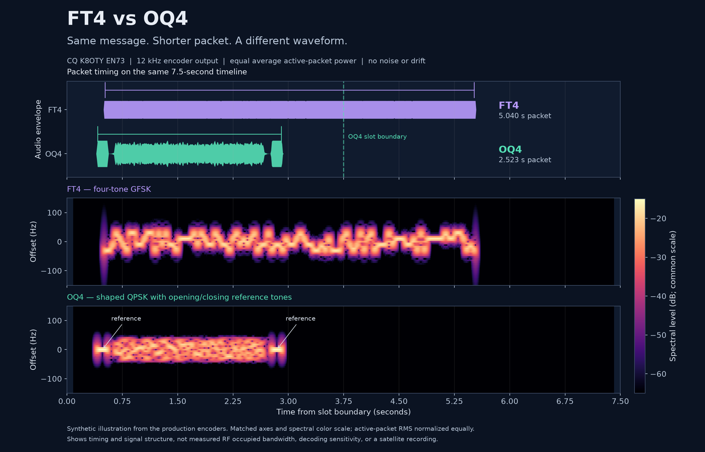

# OscarWatch-OQ4

**Quick packets, with FT4-like practical decoding observed in initial local tests.**

This is an experimental fork of [OscarWatch by Peter Goodhall, MM9SQL](https://github.com/magicbug/OscarWatch-Tracker), created to develop **OQ4**, a narrowband digital mode for short amateur-satellite contacts and terrestrial use. The tracking application, FT4 mode and upstream attribution remain intact. OQ4 development happens on [`oq4-experiment`](https://github.com/sideout909/OscarWatch-OQ4/tree/oq4-experiment).

**O** stands for **OSCAR**, **Q** for **QPSK**, and **4** for its **four phase states**. Each QPSK symbol carries two bits.

OQ4 sends a complete packet in approximately **2.523 seconds**, using **3.75-second alternating slots**. Its main draw is the opportunity to exchange useful messages more quickly during a short pass, while pursuing the weak-signal decoding ability that makes FT4 useful. Initial local observations are encouraging. Our testing has **not demonstrated a sensitivity disadvantage relative to FT4**, and no fixed sensitivity penalty is assigned to OQ4. A counted, controlled comparison is still needed to establish relative sensitivity and completed-contact performance.

[Read the detailed extended abstract](docs/OQ4_ABSTRACT.md) · [Protocol and design](docs/OQ4_PROTOCOL_AND_DESIGN.md) · [Current receiver results](docs/OQ4_SNR_AND_PHASE_TRACKING.md)



*Generated from the production encoders using the same message and equal average active-packet power. This shows timing and waveform structure, not a measured sensitivity comparison.*

## Why develop OQ4?

A satellite pass offers a limited number of opportunities to make contact. Short packets can provide more chances to exchange callsigns, locators, reports and acknowledgments before the path fades, an obstruction intervenes or the satellite sets. The project began with practical FT4 operation through RS-44 in OscarWatch and the question of whether similar useful decoding could be retained with substantially shorter transmissions.

OQ4 keeps the established message and error-control foundations already available through the FT4 implementation: 77-bit message packing, FT4 payload scrambling, a 14-bit CRC and LDPC (174,91) forward error correction. It changes the waveform, framing, synchronization and timing. **FT4 uses four-tone Gaussian FSK; OQ4 uses coherent QPSK.** An FT4 decoder cannot decode an OQ4 packet.

The OQ4 waveform uses 64-baud QPSK with root-raised-cosine shaping, a known preamble, distributed pilot pairs and tapered 160 ms center-frequency reference tones at both ends. The ideal shaped-data bandwidth is about 80 Hz. The receiver pairs references, searches timing and frequency trajectories, and uses known symbols to track residual phase. The two tones help estimate frequency change across the packet; they do not independently distinguish Doppler from oscillator or tuning errors.

The intended signal path is an appropriate existing linear satellite transponder or terrestrial SSB channel. No satellite hardware modification is required. Actual occupied bandwidth, radio linearity, fading behavior and reliable satellite QSOs still need further evaluation.

## OQ4 compared with FT4

| Property | FT4 | OQ4 experimental v1 |
| --- | --- | --- |
| Modulation | Four-tone GFSK | Coherent QPSK, RRC shaping |
| Packed message | 77 bits | Same message-packing foundation |
| Error control | CRC-14 + LDPC (174,91) | Same CRC/code; separate receiver |
| Symbol rate | About 20.83 baud | 64 baud |
| Signal width | About 83.3 Hz nominal | About 80 Hz ideal shaped-data bandwidth |
| Packet duration | About 5.04 s | About 2.523 s including references |
| Alternating slot duration | 7.5 s | 3.75 s |
| Global slot opportunities per minute | 8 | 16 |
| Practical decoding comparison | Reference mode | Initial local observations suggest FT4-like usefulness; relative sensitivity remains unmeasured |
| Interoperability | FT4 software | OQ4 software required |

FT4 parameters: [WSJT-X user guide](https://wsjt.sourceforge.io/wsjtx-main_en.html) and [FT4/FT8 protocol paper](https://wsjt.sourceforge.io/FT4_FT8_QEX.pdf). Bandwidth definitions differ: the table does not establish a measured RF bandwidth reduction. Twice the slot opportunities does not guarantee twice as many completed QSOs.

## What is implemented?

- An OQ4 transmit/receive window using OscarWatch's FT4 contact sequencer, station settings, activity colors, audio service and PTT infrastructure.
- Passband acquisition without highlighting a receive frequency, matched filtering, normal/inverted QPSK reception, and linear/curved frequency-trajectory trials.
- Fast LDPC belief propagation, bounded ordered-statistics recovery and bounded **code-assisted phase tracking** using LDPC extrinsic information.
- Approximate data SNR reports referenced to 2,500 Hz, measured from the original observations after CRC validation.
- UTC slot scheduling, prebuilt transmit audio, PTT preparation/cleanup, receive buffering and offline regression tools.

The release workflow builds the native OQ4 library and application for **Linux, Windows and macOS, on x64 and ARM64**. Download experimental packages from [our fork’s releases](https://github.com/sideout909/OscarWatch-OQ4/releases); upstream packages do not include OQ4. Some FT4-specific settings, including its AP/depth algorithms and echo calibration, are not OQ4 features.

## Evidence so far

| Evaluation | Result |
| --- | --- |
| OQ4 full-waveform corpus, BP → BP + bounded OSD | 87/144 → 92/144 correct; no earlier successes lost |
| Same corpus after adding phase feedback | 92/144 retained |
| Isolated symbol-domain phase test, +0.5 rad excursions | 254/300 → 287/300 correct |
| Isolated symbol-domain phase test, −0.5 rad excursions | 254/300 → 278/300 correct |
| Existing recorded-pass regression | 19 expected signals in 13 clips retained |
| Synthetic noise/interference regression | No decodes in 160 windows |

These are comparisons between OQ4 receiver versions, **not a controlled FT4 sensitivity comparison**. The phase tests assume synchronization succeeded. Recorded audio contains transmit bleedover and candidate returns, so the propagation path of every decode is not independently established. No general sensitivity threshold, rare false-decode rate or completed satellite QSO is claimed from these tests. The abstract also records the operator's encouraging initial FT4/OQ4 observations and their limitations.

## Run both windows for paired receive trials

Both windows can be open and listening at once. They use independent capture services and decoders; choose a **shareable input** and route the same external Decoder Lab or playback source to both. Detailed instructions and verification limits are in [paired evaluation](docs/OQ4_PAIRED_EVALUATION.md).

1. Open **Tools → OscarWatch FT4** and **Tools → OscarWatch OQ4**. Keep TX disabled and Auto Reply off during receive measurements.
2. In their shared audio settings, select a shareable input. On Linux, `pulse` or `pipewire` can expose your system audio graph; exclusive hardware inputs may not allow a second stream.
3. Route both recording streams to the same existing Lab/virtual input using your system audio controls. Confirm activity in both waterfalls. Settings changes require both receivers to restart/reopen capture.
4. Generate or replay FT4 and OQ4 trials with known timing, payloads, noise levels and drift. Match the intended comparison conditions and count correct decodes, wrong outputs, missed packets and elapsed exchange time.
5. Save each window's activity separately. Use known noise/power settings and decode counts rather than treating the two SNR labels as proof of equal sensitivity.

**Verified locally:** both production capture services received 132,608 samples each in approximately three seconds at 44.1 kHz through `pulse` with an explicitly selected existing source; stopping one left the other receiving. Two offline tests also ran both production decoders concurrently on the same mixed buffer and recovered their respective messages without modifying the input. This verifies capture/decode components and the inspected window integration, not an automated GUI or RF trial.

**FT4 may remain open and receive while OQ4 transmits.** FT4 must have TX and Tune off. During each OQ4 RF transmission, FT4 temporarily yields TX and CAT Doppler timing while its capture/decoder continue running; normal FT4 timing resumes after OQ4 cleanup. A shared PTT ownership guard prevents one modem from keying or unkeying the other's burst. The reverse arming direction is blocked during OQ4's ownership, too. Hardware/PTT behavior still needs operator validation; software checks use fake radios and do not transmit.

For controlled decoder comparisons, use the external Lab/playback source with RF TX disabled. FT4 cannot decode OQ4 packets; monitoring them in its window is useful for waveform comparison, not an FT4 decode count. Both modes need their own valid packets under matched trial conditions. Use a disconnected rig to avoid CAT tuning influencing a pure audio benchmark.

The local audio check found a saved default source naming an absent Decoder Lab device. No routing, default-device or loopback changes were made. Select an existing source explicitly if capture cannot open; see the paired-evaluation guide.

## Build and run

Requires the **.NET 10 SDK**. Clone the experiment branch:

```bash
git clone --branch oq4-experiment https://github.com/sideout909/OscarWatch-OQ4.git
cd OscarWatch-OQ4
dotnet run -c Release --project OscarWatch/OscarWatch.csproj
```

For native receiver changes on Linux x64, rebuild before launching:

```bash
cmake -S native/oscarwatch_ft8 -B build/oq4-native
cmake --build build/oq4-native --parallel
cp build/oq4-native/oscarwatch_ft8.so OscarWatch/runtimes/linux-x64/native/oscarwatch_ft8.so
```

Experimental binary packages are available from [OscarWatch-OQ4 releases](https://github.com/sideout909/OscarWatch-OQ4/releases). Starting with **1.1.6-OQ4**, update checks use this fork’s OQ4 releases, including prereleases, and ignore upstream releases. Update notifications open the download page; they do not automatically install binaries.

The OQ4 operating controls and status strip follow FT4. With **Hold TX** checked, right-click the waterfall to change TX frequency while transmission remains enabled. A waiting packet refreshes its audio without cycling the PTT port; edits after the pre-key cutoff apply to the following packet. See the [window audit](docs/OQ4_WINDOW_PARITY.md).

## Documentation and tools

- [Extended abstract](docs/OQ4_ABSTRACT.md): motivation, FT4 comparison and evidence.
- [Protocol/design](docs/OQ4_PROTOCOL_AND_DESIGN.md): framing, coding, shaping and timing; dated historical sections are superseded by later updates.
- [SNR and code-assisted phase tracking](docs/OQ4_SNR_AND_PHASE_TRACKING.md).
- [Paired FT4/OQ4 evaluation](docs/OQ4_PAIRED_EVALUATION.md).
- [Window/PTT parity](docs/OQ4_WINDOW_FT4_PARITY.md), [recording analysis](docs/OQ4_RECORDING_ANALYSIS.md), [weak-signal research](docs/OQ4_WEAK_SIGNAL_RESEARCH.md), and [handoff](docs/OQ4_HANDOFF.md).
- [Offline replay, seeded waveform generation and scoring](tools/Oq4Replay/README.md).
- [Receive-only live capture probe](tools/ModemPairProbe/README.md).
- [Original upstream README](docs/UPSTREAM_README.md): tracking features, hardware support and installation background. Its relative links and branch/build descriptions refer to the upstream root/version.

## Upstream credit and license

OscarWatch was created by **Peter Goodhall, MM9SQL**. This fork builds on that application and its existing FT4/ft8_lib integration. OQ4's message and coding foundations are inherited components; QPSK, LDPC, ordered-statistics decoding and soft-feedback synchronization are established techniques. This project experiments with their particular framing, timing and receiver combination rather than claiming those techniques as inventions.

The upstream copyright and **AGPL-3.0-or-later** license remain in place. See [LICENSE.md](LICENSE.md) and [CREDITS.md](CREDITS.md). Third-party components retain their own terms, including OrbitTools' non-commercial Public Edition restrictions described in the [upstream README](docs/UPSTREAM_README.md#orbit-propagation).
